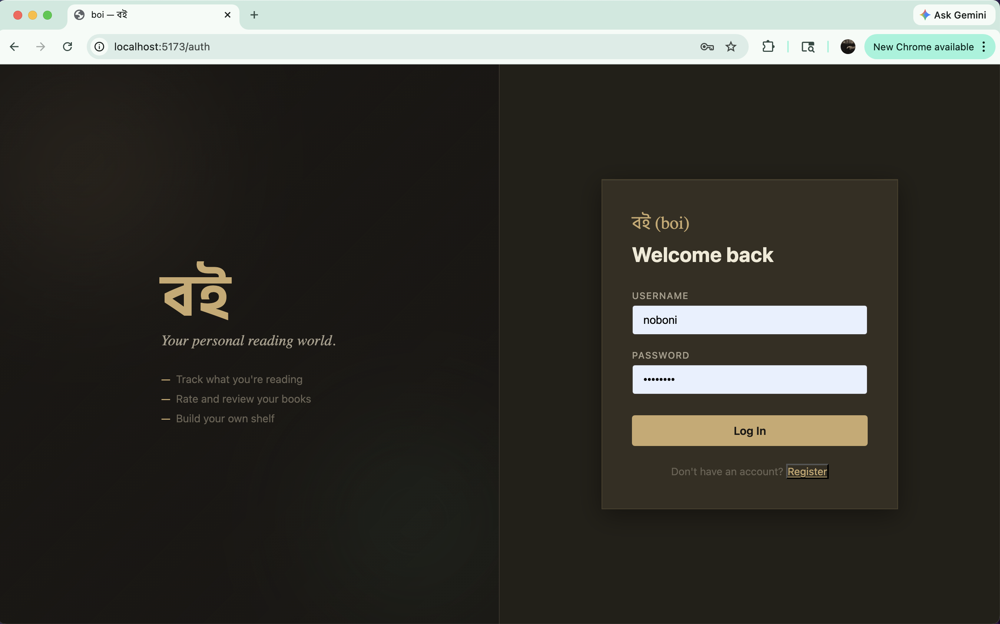
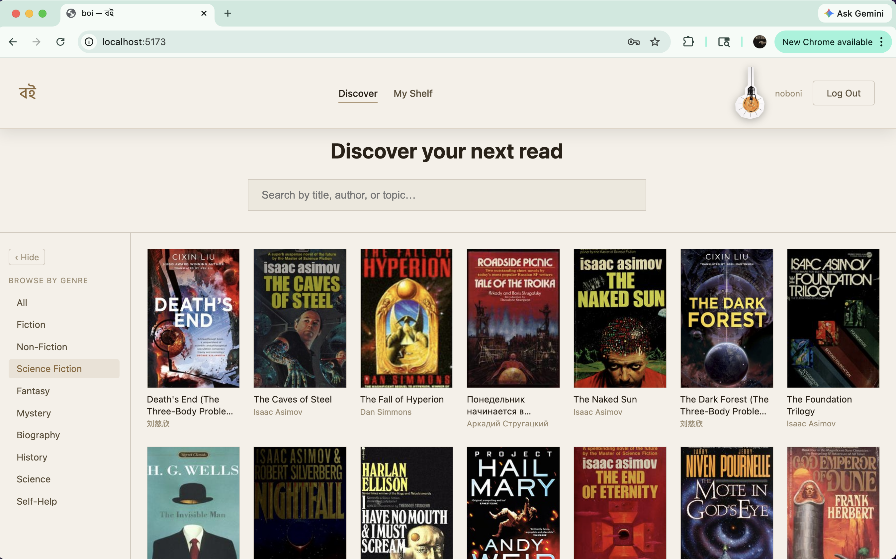

# boi (বই)

*boi (বই) means "books" in Bangla.*

**Live demo:** https://boi-noboni.onrender.com

Sign in with `alice` / `password123` to see a seeded account, or register your
own. The free Render instance sleeps when idle, so the first load after a quiet
spell takes about a minute.

**Repo:** https://github.com/The-Marcy-Lab-School-Assignments/full-stack-project-remix-NoboniSultan

---

## What is boi?

boi is a personal reading tracker for people who want to stay on top of what they're reading. Create an account, add books to your list, track where you are in each one, leave notes, and rate the ones you've finished, all in one place.

---

## User Stories

- A user can register and log in to a personal account
- A user can add books with a title, author, genre, status, rating, and notes
- A user can view all of their books
- A user can edit a book's details or update its reading status
- A user can delete a book from their list
- A user can filter their list by status (`want-to-read`, `reading`, `finished`) or genre
- A returning user with an active session is automatically logged in on revisit

### Stretch Goals

- Reading stats (total finished, average rating, top genre)
- Search by title or author
- Book detail pages with React Router
- Dark mode

---

## Tech Stack

| Layer | Tech |
|-------|------|
| Frontend | React + Vite |
| Backend | Node.js + Express |
| Database | PostgreSQL |
| Auth | express-session + bcrypt |
| Deployment | Render — one web service + managed Postgres |

---

## Database Schema

A user has many books. Deleting a user cascades to delete all their books.

```
users
──────────────────────────────────
user_id       SERIAL PRIMARY KEY
username      TEXT UNIQUE NOT NULL
password_hash TEXT NOT NULL

books
──────────────────────────────────
book_id    SERIAL PRIMARY KEY
title      TEXT NOT NULL
author     TEXT NOT NULL
genre      TEXT
status     TEXT DEFAULT 'want-to-read'
           CHECK (status IN ('want-to-read', 'reading', 'finished'))
rating     INTEGER CHECK (rating BETWEEN 1 AND 5)
notes      TEXT
user_id    INTEGER REFERENCES users(user_id) ON DELETE CASCADE
```

---

## API Contract

### Auth

| Method | Endpoint | Body | Response |
|--------|----------|------|----------|
| `POST` | `/api/auth/register` | `{ username, password }` | `{ user_id, username }` |
| `POST` | `/api/auth/login` | `{ username, password }` | `{ user_id, username }` |
| `DELETE` | `/api/auth/logout` | — | `{ message }` |
| `GET` | `/api/auth/me` | — | `{ user_id, username }` or `null` |

### Books *(authentication required)*

| Method | Endpoint | Body | Response |
|--------|----------|------|----------|
| `GET` | `/api/books` | — | Array of book objects |
| `POST` | `/api/books` | `{ title, author, genre, status, rating, notes }` | New book object |
| `PATCH` | `/api/books/:book_id` | Any updatable field(s) | Updated book object |
| `DELETE` | `/api/books/:book_id` | — | Deleted book object |

**Sample request:**
```json
POST /api/books
{ "title": "Dune", "author": "Frank Herbert", "genre": "Sci-Fi", "status": "reading" }
```

**Sample response:**
```json
{ "book_id": 3, "title": "Dune", "author": "Frank Herbert", "genre": "Sci-Fi", "status": "reading", "rating": null, "notes": null, "user_id": 1 }
```

---

## Screenshots


| Login / Register | Book List |
|------------------|-----------|
|  |  |

---

## Setup

**Prerequisites:** Node.js v18+, PostgreSQL v14+

```bash
# 1. Clone
git clone git@github.com:The-Marcy-Lab-School-Assignments/full-stack-project-remix-NoboniSultan.git
cd full-stack-project-remix-NoboniSultan

# 2. Server
cd server
npm install
cp .env.template .env   # fill in your values
npm run db:seed
npm run dev             # http://localhost:8080

# 3. Frontend (new terminal)
cd frontend
npm install
npm run dev             # http://localhost:5173
```

### Environment Variables (`server/.env`)

```env
# `pg` picks these up by name on its own — pool.js passes no config locally.
PGHOST=127.0.0.1
PGPORT=5432
PGDATABASE=boi_db
PGUSER=your_pg_username
PGPASSWORD=your_pg_password

SESSION_SECRET=your_secret_here
```

In production none of the above are set. `pool.js` instead reads a single
`DATABASE_URL` (or `PG_CONNECTION_STRING`) and connects over SSL.

### Seed Users

| Username | Password |
|----------|----------|
| `alice` | `password123` |
| `bob` | `password123` |

---

## Folder Structure

```
boi/
├── frontend/
│   ├── src/
│   │   ├── App.jsx                 # currentUser state + session rehydration
│   │   ├── adapters/
│   │   │   ├── authAdapters.js
│   │   │   └── bookAdapters.js
│   │   └── components/
│   │       ├── AuthPage.jsx        # login + register (logged-out view)
│   │       ├── BookPage.jsx        # main app shell (logged-in view)
│   │       ├── BookList.jsx
│   │       ├── BookCard.jsx
│   │       ├── AddBookForm.jsx
│   │       ├── EditBookForm.jsx
│   │       └── FilterBar.jsx
│   └── vite.config.js              # proxies /api → Express
└── server/
    ├── index.js
    ├── controllers/
    │   ├── authControllers.js
    │   └── bookControllers.js
    ├── models/
    │   ├── userModel.js
    │   └── bookModel.js
    ├── middleware/
    │   ├── checkAuthentication.js
    │   └── logRoutes.js
    └── db/
        ├── pool.js                  # local env vars, or DATABASE_URL in prod
        └── seed.js
```

---

## Deployment

One Render web service runs everything: Express serves the API *and* the built
React app from `frontend/dist`, so the browser talks to a single origin and
session cookies work with no CORS configuration.

`render.yaml` describes the whole thing. In the Render dashboard choose
**New → Blueprint**, point it at this repo, and Render creates the Postgres
instance, wires `DATABASE_URL` into the service, and generates
`SESSION_SECRET`.

Then seed the database once, from the service's shell:

```bash
npm run db:seed --prefix server
```

**Pick a service name that is not already taken.** Render releases a subdomain
as soon as its service is deleted, and short names like `boi-api` get claimed
again quickly — which is exactly what happened to the original URLs. Something
like `boi-noboni` is far less likely to be reused.

On the free plan the service sleeps after inactivity, so the first request
after a quiet spell takes around a minute.

---

## Roadmap

- Book cover art via the Open Library API
- Yearly reading goal with progress bar
- OAuth login (Google / GitHub)
- Public shareable reading lists

---

## Author

Noboni Sultan — Marcy Lab School Fellow

- GitHub: [Noboni Sultan](https://github.com/NoboniSultan)
- LinkedIn: [Noboni Sultan](https://www.linkedin.com/in/nobonisultan/)

---